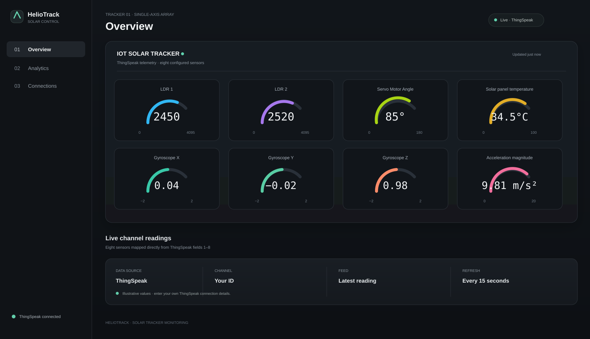

# HelioTrack Solar Tracker

A responsive web dashboard for monitoring a single-axis solar tracker. HelioTrack reads ESP32 telemetry over Wi-Fi or Bluetooth, reads a ThingSpeak channel, or runs with a built-in simulator.



## Sensor fields

The overview maps the channel's eight fields to the configured sensors:

| ThingSpeak field | Sensor | Display range |
| --- | --- | ---: |
| `field1` | LDR 1 | 0–4095 |
| `field2` | LDR 2 | 0–4095 |
| `field3` | Servo Motor Angle | 0–180° |
| `field4` | Solar panel temperature | 0–100 °C |
| `field5` | Gyroscope X | −2–2 |
| `field6` | Gyroscope Y | −2–2 |
| `field7` | Gyroscope Z | −2–2 |
| `field8` | Acceleration magnitude | 0–20 m/s² |

The ranges set the gauge scale; readings are displayed as received from the channel.

## ThingSpeak setup

1. Serve the `dist` folder as described below and open the dashboard.
2. Open **Connections → ThingSpeak**.
3. Enter your channel ID and **read-only** API key.
4. Connect. The app fetches the latest feed every 15 seconds by default.

The read key is intentionally not included in this repository. ThingSpeak connection settings are saved in that browser's local storage. The dashboard runs entirely in the browser, so a key entered there can be seen by that browser's user.

## Orbital Lab: 3D tracker simulation

Open **3D Tracker Lab** from the dashboard header, or navigate to `/tracker-3d/`. The new experience lives in its own folder and includes a perspective, orbitable Three.js model of the tracker assembly, a rotating single-axis panel, labelled hardware, auto-tracking and manual tilt controls, and eight speedometer-style gauges mapped to ThingSpeak `field1` through `field8`. A sped-up daylight cycle moves the sun and its shadows; auto tracking follows the sun angle, while manual tilt shows the resulting panel-to-sun incidence.

The lab follows the main dashboard's connectivity choices: ThingSpeak, ESP32 Wi-Fi JSON, ESP32 Bluetooth LE, and the simulator. It reuses saved settings when they exist. ThingSpeak reads the latest 200 feed entries when connected, then polls every 15 seconds. Wi-Fi and Bluetooth accept the same sensor names or normalized JSON field names; the ThingSpeak fields `field1`–`field8` are also accepted directly. It caches up to 3,000 samples per source in this browser and shows field trends, LDR comparison, and gyro history. The simulator starts with a labeled 72-point daylight sample history, then adds changing readings; demo data is kept separate from channel history. The page loads Three.js r187 from jsDelivr, so the first 3D load requires internet access.

## Run locally

No build step or package installation is needed. Python 3 is sufficient:

```powershell
python -m http.server 4173 --directory dist
```

Then open [http://localhost:4173](http://localhost:4173). Use an HTTP server rather than opening `index.html` as a `file://` URL so browser network and Bluetooth APIs work correctly.

## Other data sources

### ESP32 Wi-Fi

Choose **ESP32 Wi-Fi** in Connections and enter an endpoint returning JSON. The endpoint must allow cross-origin requests from the dashboard.

```json
{
  "angle": 124.8,
  "sunAngle": 128.1,
  "voltage": 18.6,
  "current": 0.99,
  "lux": 87200,
  "temperature": 32.4
}
```

An HTTPS-hosted dashboard cannot normally fetch an unsecured HTTP endpoint because browsers block mixed content.

### Bluetooth

Choose **Bluetooth**, enter the ESP32 BLE service and characteristic UUIDs, then pair. The characteristic can send the JSON payload above or comma-separated values in this order:

```text
angle,sunAngle,voltage,current,lux,temperature
```

Web Bluetooth support is best in Chrome and Edge on desktop and Android.

### Simulator

Choose **Simulator** to explore the dashboard without connected hardware.

## Project files

```text
.
├── docs/screenshots/      # README images
├── dist/
│   ├── app.js             # Telemetry, charts, connections, interactions
│   ├── index.html         # Dashboard markup
│   ├── styles.css         # Responsive dashboard styles
│   └── tracker-3d/         # Interactive 3D tracker and sensor instruments
└── README.md
```

## Notes

- Connection settings and custom fields are saved in browser local storage.
- Use a read-only ThingSpeak key; never use a write key in a browser app.
- The dashboard is static and can be served by any HTTP server or static hosting provider.
- Hosted demo: [HelioTrack Solar Control](https://heliotrack-solar-control.ds6918821.chatgpt.site).
